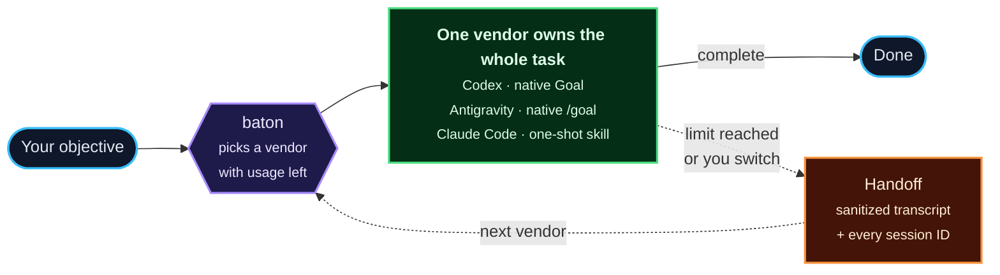

# baton


baton keeps coding work moving between Codex, Antigravity and Claude API while enforcing each
vendor's usage and spend limits. By default, one vendor owns the whole task and uses its native
tools, goals, skills and subagents. Baton hands the task to another vendor only when a configured
limit is reached or you request a switch.

You give it an objective and a working directory, with an optional verification command. The
current vendor works until it completes the task or reaches its configured limit. When every
vendor is out, Baton waits for the earliest reset and continues with the next one. With a verify
command, exit 0 confirms completion; without one, the vendor's completed response ends the task.

Every agent runs through its vendor's own CLI. baton reimplements no agent. Context moves between
vendors through the repository, commits and a sanitized conversation transcript; each vendor's
native session ID is saved and resumed if Baton returns to it.

The default is native one-shot task execution. Baton-managed plan, build, review and consensus are
available when `phases = true` (see [Phases](#phases-plan-build-review)).



One vendor works until the task is complete or its configured limit is reached. On a limit, Baton
transfers the full sanitized conversation and every native session ID to the next vendor. Codex
and Antigravity use their native persistent Goal features; Claude Code uses its native skill,
task, and session tools because its CLI integration has no persistent Goal primitive. See the
[Codex Goals guide](https://developers.openai.com/cookbook/examples/codex/using_goals_in_codex),
[Antigravity `/goal` guide](https://antigravity.google/docs/commands/goal), and
[Claude Code skills guide](https://code.claude.com/docs/en/skills). `phases = true` opts into
Baton-managed plan/build/review and consensus.

## What you need

baton does not bring its own AI or its own methods. It drives tools you install, and works with
two projects it did not write. Everything it depends on or works with:

| Project | What it does for baton | Required? | How to install |
| --- | --- | --- | --- |
| [uv](https://docs.astral.sh/uv/) and Python 3.12 or newer | installs and runs baton; baton itself has no other dependencies | required | the installer on [astral.sh/uv](https://docs.astral.sh/uv/); uv fetches Python 3.12 when it is missing |
| [OpenCode](https://opencode.ai) | the chat window you type in; baton shows up in it as the model `baton/auto` | only for the chat interface: `baton run` works without it | the installer on [opencode.ai](https://opencode.ai) |
| [Codex CLI](https://github.com/openai/codex) | runs GPT models, through your plan | at least one of Codex and Antigravity, signed in to a plan | `npm install -g @openai/codex`, then sign in |
| [Antigravity CLI](https://antigravity.google) (`agy`) | runs Gemini models, through your plan | at least one of Codex and Antigravity, signed in to a plan | the installer on antigravity.google, then sign in |
| [Claude Code](https://claude.com/claude-code) | an optional third in the queue, paid by use: a turn ends at USD 50 or 5 hours, and a goal leaves it out after USD 150 | optional; needs a Console API key, not a subscription | install Claude Code, then save the key (Quick start, step 3) |
| [Superpowers](https://github.com/obra/superpowers) | planning, test-driven building, verification and review methods for Baton-managed phases | optional; used when `phases = true` | `git clone https://github.com/obra/superpowers ~/.config/baton/superpowers`; it is also found automatically from the official Claude Code plugin install |
| [ai-memory](https://github.com/akitaonrails/ai-memory) | long-term memory across goals in the same directory | optional | download the release binary for your platform from its releases page and put it on `PATH`; do not run `ai-memory setup`, which wires global hooks (see [Long-term memory](#long-term-memory)) |
| launchd | keeps `baton serve` running in the background on macOS | macOS only, recommended: `baton install-service` | built in to macOS; on Linux keep `baton serve` running in a terminal or tmux |

baton was tested with Codex CLI 0.166.0, Claude Code 2.1.318 and ai-memory 3.4.1. The stream formats
and hook options it relies on are version-specific, so other versions may not behave the same.

**How the pieces fit.** Baton owns vendor limits and handoffs. Each vendor CLI does the task using
its own native workflow. Codex's persistent Goal feature is enabled in one-shot mode. Superpowers
is used by the optional Baton-managed phases. ai-memory gives goals long-term memory. OpenCode is
the chat window in front of it all.

## Superpowers is only needed for phase mode

One-shot tasks use each vendor's native tools and skills and do not require Superpowers. When a goal
sets `phases = true`, Baton uses Superpowers for plan/build/review. Install it with the command in
the table above; `baton doctor <goal.toml>` checks it for a phased goal. Baton finds it automatically
from the official Claude Code plugin install or `~/.config/baton/superpowers`; an install elsewhere
needs `[superpowers] dir` in `defaults.toml`.

## Install the native one-shot skill

Baton includes the portable `baton-oneshot` Agent Skill. It tells each vendor to own the complete
task in one session, use the vendor's native skills and long-running workflow, verify every
deliverable, and leave handoffs to Baton. Install it once after installing Baton:

```
baton skills install
```

The command installs the skill in Codex, Claude Code (including the isolated config Baton uses for
Claude API sessions), and Antigravity's shared global skill folder. Re-run it after upgrading Baton
to refresh the skill. If a different skill already uses that name, review it first and then use
`baton skills install --force` to replace it. The full instructions are in
[`src/baton/skills/baton-oneshot/SKILL.md`](src/baton/skills/baton-oneshot/SKILL.md).

## Quick start: from zero to your first task

This walks you through everything once, with no prior knowledge of baton. It takes about 15
minutes. The commands assume macOS; on Linux everything works except the background service, so
use the note in step 4.

**Before you start.** Get the tools in [What you need](#what-you-need): at least one of `codex` or
`agy`, signed in to your plan, plus OpenCode for the chat window. Superpowers is optional and only
needed if you choose Baton-managed phases.

### 1. Install baton

```
git clone https://github.com/cahian/baton.git
cd baton
uv tool install .
baton skills install
```

For phased goals only, install Superpowers with
`git clone https://github.com/obra/superpowers ~/.config/baton/superpowers`.

### 2. Create your settings

```
mkdir -p ~/.config/baton
cp examples/defaults.toml ~/.config/baton/defaults.toml
```

Claude is optional. Open `~/.config/baton/defaults.toml` in any text editor and pick one of these:

- **No Claude (the simplest):** change nothing, and skip step 3. Without a saved key, Claude never
  runs and baton uses Codex and Antigravity only. To switch it off for good, set `enabled = false`
  under `[agents.claude_api]`.
- **With Claude:** set `monthly_budget_usd` to the credit you actually have, and
  `budget_reset_day` to the day of the month it renews. baton stops 10% before that number. Then
  do step 3. Claude joins the queue after the other two; its turn ends at USD 50 or 5 hours,
  whichever comes first, and a goal leaves it out after USD 150. To keep it for last, so that it
  runs only while the others are out, set `reserve = true` under `[agents.claude_api]`.

Change `enabled` for `codex` or `antigravity` the same way if you only have one of them.

### 3. Add the Claude key (optional)

Create an API key in the [Claude Console](https://platform.claude.com) and copy it. Then run this,
which saves what you copied into a file only you can read:

```
touch ~/.config/baton/anthropic.key
chmod 600 ~/.config/baton/anthropic.key
pbpaste > ~/.config/baton/anthropic.key
```

Do not paste the key into a chat or into a project.

**Check your billing first.** baton cannot see or change it. If the Console has auto-reload on, or
holds credits you bought, using the key can spend that money. Turn auto-reload off.

### 4. Start baton and check it

```
baton install-service
baton doctor
```

`install-service` keeps baton running in the background, even after a restart. Every line of
`doctor` should read `ok`; with no Claude key it says `claude_api: not configured (optional)`,
which is fine. `FAIL` tells you what to fix; `warn` is only a heads-up. It spends
nothing, so run it as often as you like.

> **On Linux**, skip `install-service` and leave `baton serve` running in a terminal.

**Optional: long-term memory.** Put the `ai-memory` binary on your `PATH` and baton does the rest;
without it baton works exactly as before. See [Long-term memory](#long-term-memory).

### 5. Add baton to OpenCode

```
baton opencode-config
```

This prints a block of settings. Where it goes depends on whether you already use OpenCode:

- **No `~/.config/opencode/opencode.json` yet:** save it directly:

  ```
  mkdir -p ~/.config/opencode
  baton opencode-config > ~/.config/opencode/opencode.json
  ```

- **You already have that file:** do not run the command above, it would erase your settings.
  Open the file and copy the `baton` entry into your existing `provider` section.

Then tell OpenCode to read the change. If you skip this, baton will not show up:

```
opencode reload
```

### 6. Connect it, once

Use a throwaway folder for your first try. **The agents have full access to the folder where you
open OpenCode**, so do not start in a project you care about:

```
mkdir -p ~/baton-test
cd ~/baton-test
git init
opencode
```

1. Type `/models`. Searching for `baton` shows **No results found**. That is expected the first
   time.
2. Press `ctrl+a` to see all integrations, and choose **baton**.

   

3. It asks for an API key. baton does not need one, but the box cannot be empty. Type `local`
   and press Enter.

   

4. Type `/models` again and choose **Auto**. If OpenCode asks for a variant, keep **Default**.
   baton ignores this setting; effort is set in your `defaults.toml`.

   

You are ready when the box at the bottom says **Auto baton**:


OpenCode remembers the connection, but check that label whenever you open a new session.

### 7. Send your first task

```
Create a hello.py that prints "hi" and run it to check.
```

The answer streams in the chat like any other model. One vendor handles this request through its
own workflow. A line appears when Baton hands the task to another vendor at a configured limit.
While it works:

- **To change direction,** just send another message. It reaches the agent after its current tool
  call (never later than five minutes after), including a message you type while a reply is
  streaming, which OpenCode would otherwise hold until the reply ends.
- **Closing OpenCode does not stop the work.** It keeps running in the background.

### 8. Watch it, or stop it

Run these in another terminal:

```
baton jobs                   # everything running; names look like session-<id>
baton status session-<id>    # where it is and what it has spent
baton stop session-<id>      # stop it
baton doctor                 # limits and spending right now
baton restart                # restart the gateway between rounds (see Keeping it running)
```

### 9. Let it run until the job is really done

By default, the work ends when a cycle ends, which for a small request is one round. For a long goal, give baton a test to pass: create a
file named `baton.toml` in your project with the command that proves the job is finished.

```toml
[verify]
command = "./check.sh"
timeout_s = 3600
```

baton then keeps going, across agents and limit resets, until that command succeeds. An agent
saying "done" does not count. Without a good check it may stop too early, and with an impossible
one it will keep trying, so choose something you trust.

### If something goes wrong

| What you see | What to do |
| --- | --- |
| `baton` is not in `/models` | Run `opencode reload`, reopen OpenCode, then do step 6. |
| It asks for an API key | Type `local`. |
| The model still is not listed | In your project, run `echo '{"model":"baton/auto"}' > opencode.json`, then reopen OpenCode. |
| The answer never starts | Run `baton doctor` and `baton jobs`. |
| It says it is waiting | Every agent hit its limit. It resumes alone at the next reset. |
| You want to go back to another model | Choose it in `/models`. Nothing else changes. |

## The rotation

The default order, all at medium effort (the strong tier; [Phases](#phases-plan-build-review)
adds a working model for building):

1. **GPT-6.1 Sol**, through Codex.
2. **Gemini 4 Argon**, through Antigravity (`agy`).
3. **Claude Opus 5.5**, through a Console API key (never a subscription login).

That is the queue. In the default one-shot mode, the current vendor owns the whole task. It gives
way only when the task completes, you choose another vendor, or a configured limit is reached.
An unfinished task switches after **5 hours of work**, or sooner when its usage limit runs out.
Only time spent in a round counts: cooldowns, waits and stopped services do not. Claude's turn also
ends at **USD 50**, whichever comes first, and after **USD 150** spent in
one goal (a goal is what you pin with `baton: goal`) Claude is left out of the queue until the goal
changes. The others have no budget of their own. Claude is paid by use and has no reset that would
ever stop it, so the ledger's monthly ceiling (see [The Claude ledger](#the-claude-ledger))
stays above all of this.

**Claude is optional.** baton works with Codex and Antigravity alone: until you save a key file
(Quick start, step 3), Claude never runs and the rotation is the other two. It joins the queue
once the key is there. To turn it off for good, set `enabled = false` under `[agents.claude_api]`
in `defaults.toml`, or leave it out of `order` in a goal file. `baton doctor` reports an
unconfigured Claude as one `ok` line, not a problem.

The first agent in `order` starts. When an unfinished task reaches a limit, Baton moves to the
next available vendor and carries the full sanitized transcript and all native session IDs. It
does not alternate vendors between steps. `baton: use claude` (or `baton use <job> claude`) selects
Claude API directly; `baton: use codex` and `baton: use antigravity` select the others. `baton: next`
moves to the next vendor in the queue. These changes happen between tool calls; `now` asks Baton to
switch after the current tool call. When no vendor can run, Baton waits for the earliest reset and
continues the task afterward.

**Reserve.** With `reserve = true` under `[agents.claude_api]`, Claude leaves the queue and waits
for the others, wherever it stands in `order`: it runs only while every other agent is out. While
it does, baton reads the others (without a model call) from their reset time onward, at most every
30 seconds, and as soon as one is available it ends the Claude round and that agent takes over.
If more than one is, the first in `order` goes first. This is not a failure: Claude gets no
cooldown. An agent whose round fails within five minutes of such a takeover stops being allowed to
end Claude rounds until it completes one. At most six Claude rounds a day are ended this way
(`baton status` says when the cap is active). Without `reserve` (the default) none of this
happens.

Claude's turn also ends at its time or spend limit. The limits are settings (`turn_max_s` for every agent, in
seconds, default 18000; `turn_budget_usd`, default 50, and `goal_budget_usd`, default 150, for
Claude). They go in `defaults.toml` or in a goal file. A repository's `baton.toml` may only lower
them (and `round_budget_usd`), may not turn a `reserve` off, and may not enable an agent that
`defaults.toml` disables. Claude reports a session's cost as a running total, so a resumed round counts only what it added to the last total baton saved for that session. A round that ends without a cost report (killed, timed out) counts its
whole reservation against the turn and the goal, as the ledger does. Change the
order, or disable an agent, in the goal file.

## Phases: plan, build, review

This is an opt-in workflow. Set `phases = true` in a goal file or `baton.toml` to use Baton-managed
plan/build/review; the default `phases = false` gives one vendor ownership of the entire task.

Each provider has a strong model for thinking and a working model for building, and baton applies
the same discipline to all three:

| Provider | Plan and review | Build |
| --- | --- | --- |
| Codex | `gpt-6.1-sol`, medium | `gpt-6.1-terra`, high |
| Antigravity | `gemini-4-argon-medium` | `gemini-3.8-flash-high` |
| Claude | `claude-opus-5-5`, medium | `claude-sonnet-5-5`, high |

This is separate from the rotation: the scheduler still decides who works, and the phases decide
what that agent does and which of its two models runs. State lives in `.baton/PLAN.md` and
`.baton/REVIEW.md`, so any provider can continue a cycle.

1. **Plan** (strong). The agent writes `.baton/PLAN.md` with one `- [ ]` line per task. A request
   small enough to do at once gets no tasks, and the cycle ends there.
2. **Build** (working). One task per round, marked `- [x]` when done. Two completed rounds in a row
   that close no task move on to review; so do 8 rounds in a row of any outcome that close none,
   and so does the build's round cap (3 per task open when the build began, plus 5; a review that
   sends the build back renews it).
3. **Review** (strong). A fresh conversation, by another provider when one is available. It writes
   `.baton/REVIEW.md`, starting with `APPROVED` or `CHANGES`, and adds `- [ ]` tasks for changes.
   Changes go back to build at most 2 times; a third `CHANGES` ends the cycle.
4. **End of cycle.** The verify command runs here, and a failed run goes back to plan. It also
   runs after every 3 rounds without a phase change, whatever their outcome (a timeout resumes
   rather than advances), and a pass finishes the goal as usual (with a goal set, it starts
   [consensus](#a-goal-ends-only-when-its-check-passes-and-every-agent-approves) instead). With no
   verify command, the end of a cycle finishes the goal.

A note from a person in the middle of a cycle is delivered as before, outranks the current task,
and changes no phase; a new message starts a new cycle at plan, and `.baton/PLAN.md` and
`REVIEW.md` of the cycle before are moved to `.baton/archive/` (a failed verify keeps them). A
round that does not complete leaves the phase as it was, so the next agent repeats that work. A
Claude round cut off by its own budget cap counts as not complete for the phase and does not
finish a goal. In a directory that is not a git repository there is nothing to review: baton says
so once and ends the cycle after build. With `phases = false`, the native one-shot flow is used
instead and the vendor works on the entire task in its own session.

**Two guards on the review, enforced by baton and not by a prompt.** baton deletes `REVIEW.md`
just before a review round and reads the verdict only after a round that completed, so an old
`APPROVED` can never approve anything. And if a reviewer changes the code (HEAD moves, or any
tracked or new file outside `.baton/` changes), the review is void: it counts as `CHANGES`, a
`phase` event says `reviewer changed the code`, and a task to review those changes is added to the
plan. A reviewer editing a gitignored file is not detected.

### A goal ends only when its check passes and every agent approves

These rules apply only when `phases = true`. In that mode, a goal set with `baton: goal <text>`,
`baton goal`, or `oneshot` ends only after its check passes and every eligible agent approves. This
requires a git repository because approvals are bound to the tree. In default one-shot mode, a
pinned goal is context for the vendor; `verify.command` still checks the work, and `oneshot = true`
is allowed with `phases = false`.

The check is `verify.command` when the goal file has one. Otherwise it is `.baton/VERIFY.sh`, which
the plan writes: it must exit 0 only when the goal is met as the person would experience it, in the
real setup, with no rounding, a check that measures a stand-in fails the check, and it writes only
under `.baton/` or outside the working directory (anything else it leaves in the tree counts as a
change to the work). With no check the gate fails with `no check`, and the plan stays in plan, with
tasks or without, until `.baton/VERIFY.sh` exists. The gate before round 1 and the periodic one run
only with a check that exists.

- **The check is locked.** At the end of each completed plan round baton saves the script's hash,
  and keeps its first version in the state directory (`verify.first.sh`). A gate that finds another
  hash fails with `the check changed outside plan` and alerts, so a build round cannot weaken it
  silently. A plan round may change it; consensus then shows every approver the diff against the
  first version, and tells them to reject a weaker check. When a goal ends or changes, the script
  moves to `.baton/archive/` with the lock and the first version: the next goal writes its own.
- **Consensus.** A pass starts it: every agent in `order` that can run (not left out for its goal
  budget, and not one that can never run: disabled, no usable key, or a `round_budget_usd` below
  the minimum) takes a fresh, strong round, one at a time, without moving the queue or its turns,
  and with no round tail and no preemption watch. Every approver is shown the check itself (the
  command or the script) and told to reject one that cannot fail or measures a stand-in. It may not
  change the tree or the check, reruns the check itself, inspects real evidence, and writes
  `REVIEW.md` with `APPROVED` or `CHANGES` first (`APPROVED only if ...` is not an approval). An
  agent out of quota is waited for (`waiting for <agent> to approve`, said once per reason); a round
  that did not complete is retried, and three in a row count as one failed cycle; an agent that
  crosses its goal budget in the meantime leaves the list, and the chat says so.
- **An approval belongs to a state.** When the gate passes baton records the tree (HEAD and every
  changed file outside `.baton/`) and the check's hash. After every consensus round, completed or
  not, on a restart, and just before the goal ends, they are compared: a change rejects, consensus
  ends and the work goes back to build, with a note naming the changed paths from `git status`. A
  clean round's own snapshot commit moves the record along. Before it ends, baton also looks again
  at the goal (changed or cleared ends the approval) and asks anyone who can run now and has not
  approved. Everyone approving ends the goal: `[baton] goal achieved: check passed, approved by
  codex, antigravity, claude_api`, and the goal is archived.
- **The goal's terms are saved.** When a goal is first seen baton saves its terms in `state.json`
  (`goal_terms`: the verify command, `order`, which agents are enabled, and every agent's
  `round_budget_usd`, `turn_budget_usd` and `goal_budget_usd`, which a repository's `baton.toml` may
  lower and so take Claude out of consensus). A later difference, from
  a `baton.toml` an agent edited or anything else, fails the gate with `the goal's terms changed:
  <what>` and an alert, and voids a consensus under way, until the person sets the goal again with
  `baton: goal` or `baton goal` (the same words will do), which saves the terms as they are.
  Consensus shows the saved verify command.
- **The check runs once more at the end.** Just before the goal ends baton runs the check again:
  the tree comparison cannot see what git ignores (a `dist/`, a build). A failure rejects, back to
  build, and a goal that changes while any check runs does not get that run's result: the check runs
  again for the new goal.
- **A no goes back to build.** `CHANGES`, a missing verdict or a changed tree ends consensus: the
  review becomes a note, a task goes to the plan, and the chat says `[baton] <agent> rejected:
  back to build`. A message from the person during consensus ends it the same way, and `next` is
  taken and dropped with a `[baton]` line.
- **No giving up.** Every 3 cycles that end with a failed gate or a rejection, baton alerts `no
  progress in N cycles: still working`, and carries on.

**Hardening, and the trust boundary.** Every git call baton makes runs with `core.fsmonitor`,
`core.hooksPath` and `core.pager` neutralised, so those cannot run a program inside baton. Other
config still can: a repository's `filter.*` (clean and smudge) programs run inside git, and baton
does not disable filters. What stops them forging an approval is the order: an approver's
`REVIEW.md` is read before baton's next git call. The tree record
also covers tracked files hidden with `skip-worktree` or `assume-unchanged`. Baton sets
`BATON_ROUND=1` in every agent's environment, and the commands that steer a goal (`baton goal`,
`next`, `restart` and `stop`) refuse to run under it, so an agent's shell cannot accept its own
changed terms or clear the goal. This only raises the bar: agents run as the same user with full
access to the machine, so a determined agent can still write to baton's own state directory (the
goal file, `state.json`, `verify.first.sh`) or unset the variable. The protection is the check and
the consensus, which guard the work and the check, not baton from the agents it runs. Helper files
a check calls beside it are not locked either.

**Subagents are allowed on the provider's two models.** A subagent may use only the strong or the
working model of its provider, exactly, and what enforces that differs by provider.

- **Claude:** every subagent runs on the working model (Sonnet), because baton sets
  `CLAUDE_CODE_SUBAGENT_MODEL` with `CLAUDE_CODE_SUBAGENT_MODEL_FORCE=1`, which makes Claude Code
  drop the `model` parameter: a named model is replaced, not denied. A `PreToolUse` hook stays as a
  second check, and in practice only denies unreadable input or an empty allowed list.
- **Codex:** a `PreToolUse` hook, given per run with `-c` (nothing in `~/.codex` is touched, and
  `features.hooks=true` keeps a config file from turning hooks off), denies a spawn naming a model
  outside the pair before the subagent exists, with a message naming the two allowed ones; the agent
  can retry with an allowed one. A subagent that names no model inherits, unless a role pins one. A
  Codex spawn may not appear in the stream, since the block is in the hook.
  `--dangerously-bypass-hook-trust` also runs any other enabled Codex hooks without review, which
  adds no new capability, since `verify.command` already runs commands.
- **Antigravity:** no hook. baton ends the round (a `subagent` outcome, followed by a pause; three
  in a row rest that agent) when a forbidden model is visible in the stream, and otherwise only
  logs, since its model is rarely shown.

For Claude and Codex the stream only logs subagents as `subagent` events, shown in `baton status`;
it never ends a round. Subagent spend is included in a Claude round's reported cost, which Claude
checks between steps, so `--max-budget-usd` is a soft limit: a round can pass it slightly, and the
10% reserve covers that. Claude runs with a config directory of baton's own
(`<state base>/.claude-config`, mode 700), so a `~/.claude.json` `env` map cannot replace the key or
the base URL.

**Superpowers is applied in every phased round** (it is [optional outside phase mode](#superpowers-is-only-needed-for-phase-mode)). baton puts
the methods that fit each phase in the prompt of a fresh conversation, under `Skill: <name>`
headings: `writing-plans` for plan, `test-driven-development` and `verification-before-completion`
for build, the code-reviewer prompt for review, and `systematic-debugging` for the plan after a
failed verify, even in a resumed conversation. The phase's own instructions come last. It leaves
out the skills that conflict with baton's own workflow, and says baton's files outrank the
methods'. To use another install, set `[superpowers] dir` in `defaults.toml` (a directory named
there is final: if it is incomplete, Superpowers counts as missing); a repository's `baton.toml`
cannot set it. Files over 64 KB, or 128 KB of text in all, count as missing.

## Long-term memory

`.baton/HANDOFF.md` is short-term: it dies with the goal. [ai-memory](https://github.com/akitaonrails/ai-memory)
is the long-term layer: what past rounds did and learned, searchable, across goals in the same
directory. It adds to the handoff and never replaces it. It is optional: without the binary, or
with memory off, nothing changes, and a memory failure can never stop a goal.

**baton drives it; the agents do not.** baton calls the `ai-memory` command itself, between rounds,
so the same memory reaches Codex, Antigravity and Claude alike. It uses no hooks and no MCP, and
never runs `ai-memory setup`, `install-hooks`, `install-mcp` or `run`.

**What is stored, and where.**

- Before every round, baton searches the project's memory with words from the last verify output
  (at most 16 of them) and the objective (the rest, up to 24 in all), and puts the best 5 hits (6000 characters at most) in the prompt, labelled as
  context that may be out of date, not as instructions. Words are taken from the end of the
  verify output and of the objective, where the errors and the newest message are. Each hit is
  the page itself, not search's short snippet: baton reads it and puts in the prompt the part
  around where the search matched (the head when it cannot tell), sharing the 6000 characters
  among the hits, 1200 at most for each. Pages that hold lessons come first, and the pages of
  this goal's own rounds are left out, since the handoff already carries them. The hits sit
  between `--- BEGIN BATON MEMORY ---` and `--- END BATON MEMORY ---`, one line each, starting
  with the page's date and goal.
- After a round that started a process, baton stores one page: the date, the agent, how it ended,
  how long it took, the gate result, the commits it made, and the tails of the verify output, the
  handoff and the round. It is written when the round ends and again, over itself, once the
  verify has run, so a baton killed during the verify still leaves its page. A round that fails,
  times out or has a failing verify is kept as a "gotcha"; a stop, an interrupt, a takeover by
  another agent or a limit is normal rotation.
- Agents are told to keep durable findings under a `## Lessons` heading in the handoff. baton also
  takes `## Lessons ...` and `### Lessons ...` headings and list items that start with
  `**Lessons`, with their indented lines (code fences are skipped). When that changes, baton
  stores it as a pinned page that outlives the goal. Each round's page is announced in
  `baton status` as a `memory` event `recorded`.
- ai-memory redacts secrets before it stores anything. Memory is per directory: a project is the
  directory's name plus a short hash of its full path, and a search never leaves it.
- The data is in `~/.local/state/baton/.ai-memory` (mode 700), with its own config and its own
  port, `127.0.0.1:18778`, so it never meets another ai-memory on the machine. The leading dot
  keeps it clear of every goal's state directory, since no goal can be named that.
  `BATON_STATE_DIR` moves it.
  baton starts the server when it first needs one and leaves it running.
- ai-memory gets only `PATH`, `HOME`, `TMPDIR`, `NO_COLOR` and `RUST_LOG` in its environment, so no
  provider key can reach it, and baton configures no model for it: it uses none.

**Install it** as in [What you need](#what-you-need): the release binary from the
[ai-memory releases](https://github.com/akitaonrails/ai-memory/releases) on your `PATH`, or `bin`
below set to its path. Do not run `ai-memory setup`: it wires hooks into every session on the
machine, which is what baton avoids. Then run `baton doctor`: the
`memory` line shows the binary found and whether the server is up. If you run baton as a service,
re-run `baton install-service` after installing ai-memory, so the service can find it.

**Turn it off.** `memory = false` in a goal file or `baton.toml` turns it off for that project.
`BATON_MEMORY=off` in the environment turns it off everywhere. In `defaults.toml`:

```toml
[memory]
enabled = true
bin = "ai-memory"      # a name on PATH, or a path
port = 18778           # 1024-65535
recall_chars = 6000    # 0-20000; 0 stops recall, recording goes on
```

A `baton.toml` that comes with a repository can only turn memory off or on; it cannot set `bin`
or `port`. A `[memory]` table that cannot be read turns memory off, with one line in `baton status`
and a warning in `baton doctor`.

**Limits.**

- One memory call, starting the server included, is given 8 seconds in all. After any failure
  (server dead, garbage output) baton skips memory for 300 seconds, so a broken memory costs a
  round one short wait at most. A page that cannot be read does not stop memory: for 300 seconds
  the hits are search's snippets instead of pages. A missing binary costs nothing and says nothing; `baton doctor`
  warns. Failures show in `baton status` as `memory` events, never in the chat.
- If you change `port` while the old server is still running, baton starts no second one: it says
  so, in `baton status` and `baton doctor`, and you stop the old server (or set the old port
  back). baton never stops it for you.
- A round that baton had to kill is still recorded, as `interrupted`.
- Recall is keyword search, not understanding: it finds earlier pages that share words with the
  failing output or the objective. It can miss, and it can return something stale.
- Lessons longer than 10000 characters are cut to their last 10000.
- Goals in one directory share one memory; the pages are told apart by goal name.

## How each agent is stopped before it costs money

The failure this exists to prevent: at 100% of its included usage, the Codex CLI keeps working
and silently debits account credits. No error is raised. A design that waits for a limit error
has already paid, so baton reads the limits and acts before they are reached.

| Agent | What is read | Stop condition |
|---|---|---|
| Codex | `codex app-server` rate limits and credit balance. No model call, nothing spent. | 90% used in any window, or the credit balance drops |
| Antigravity | the `/usage` and `/credits` slash commands. No model call, nothing spent. | 90% used in any Gemini row, or the credit balance drops. Both `Gemini Models` rows, Five Hour and Weekly, must be readable |
| Claude | baton's own spend ledger (there is no API that returns the balance) | a spend ceiling of 180 USD by default, and a per-round cap |

Rules that apply to all of them:

- Limits are read before a round and every few seconds during it (15 s for Codex, 30 s for
  Antigravity by default). Reaching the threshold stops the round.
- A balance that moves between the read before the round and any read during it kills the round
  at once (`credit_guard`). Balances are compared as exact decimals.
- Unknown means stop. A read that fails or cannot be parsed never lets an agent run, and two
  failed reads in a row during a round stop it.
- Every agent process has the vendor API-key variables removed from its environment, so a CLI
  cannot fall back to paid API access. The Claude adapter adds its own key back for its process
  only. Before the key is added, every `ANTHROPIC_*`, `CLAUDE_CODE_USE_*`, `CLAUDE_CODE_OAUTH_*`,
  `CLAUDE_CODE_*_FILE_DESCRIPTOR` and `AWS_BEARER_TOKEN_BEDROCK` variable is dropped from the
  Claude round, and a round whose `init` event shows any other credential (a subscription login) is
  refused at once, before any model call.

### The Claude ledger

Claude is billed to the organization's promotional credit, and no API reports what is left, so the
budget is baton's own:

- `monthly_budget_usd` (default 200) minus `reserve_pct` (default 10) is the spend ceiling, 180
  USD. The reserve also absorbs the error of the cost estimate.
- Spend is summed from `total_cost_usd` in each round's result, in one ledger shared by every
  goal (`~/.local/state/baton/claude-spend.json`), under a lock. A period starts on
  `budget_reset_day` at 00:00 UTC.
- Before a round, baton reserves `round_budget_usd` (default 5), passed to Claude as
  `--max-budget-usd`: a soft limit, since the cost (a subagent's included) is checked between
  steps, so a round can pass it slightly and the reserve covers that. If the ceiling would be passed, the round shrinks to what is left, and below
  5 USD the agent is unavailable until the next period.
- A round that ends without a result keeps its whole reservation counted. Crashes overcount and
  never undercount. So does a round ended because another agent came back (`reserve = true`): it has no result, and
  whatever it spent before is counted as the whole 5 USD. The ledger drifts high, never low, and
  the small default keeps that drift small. A corrupt ledger makes the agent unavailable; it is never recreated silently.
- Optionally, `admin_key_file` points to an Admin API key. baton then also reads the Console cost
  report and uses the larger of that and the ledger. It never lowers the ledger, and a failed read
  makes the agent unavailable.
- With no key file, Claude is unavailable with a clear reason and the other agents carry on.

## Honest limits

- **There is a poll gap.** A round can cross from the threshold to 100% between two polls. The 10%
  margin exists for this, and it cannot be made mathematically zero. The account's own setting for
  credits, where it exists, remains the only hard stop.
- **Claude spend is an estimate.** It is computed locally from what the CLI reports. The hard stops
  are in the Console, not in baton.
- **Some Console settings must be right, and baton cannot check them with the key.** Turn
  auto-reload off and hold no purchased credits, since otherwise spending continues after the
  promotional credit ends. Put the key in a dedicated workspace with a monthly spend limit at the
  ceiling. `baton doctor` prints this reminder.
- **Interactive sessions outside baton are not protected.** Codex and Antigravity share one set of
  limits and credits between baton and anything else you run. baton cannot stop your own session,
  but a balance drop it causes still stops baton's round.
- **Antigravity's output when its quota actually runs out has not been observed.** The limit reads
  are expected to stop it first.
- **Masking is by pattern.** Before it is shown, kept in the round tail or put in the log of events,
  the agent's output has the value of `Bearer ...` and of `token`, `api_key`, `secret`, `password`
  and `passwd` assignments (also in a longer name such as `DB_PASSWORD`) and the well-known token
  shapes (`sk-`, `ghp_`, `AKIA`, `xoxb-`) replaced by `[masked]`. A quoted value is masked from 8
  characters, spaces included. An unquoted value is masked only when it holds a digit or a symbol
  other than `.`, `_`, `-`, so code such as `password = self.password` is left alone: **an unquoted
  value of letters only is not caught.** A placeholder (`$TOKEN`, `${TOKEN}`, `<token>`) is never
  masked. A secret in another shape, or split across two streamed fragments, is not caught either,
  and the raw round log keeps what the agent printed. The next agent is told what `[masked]` is.
- **A response held open for days through OpenCode is untested** beyond seconds. The job does not
  depend on it: `baton jobs` and `baton status session-<id>` show where it is, and a new message
  in the session reattaches the stream.

## Install

```
uv tool install .
baton doctor
```

Python 3.12 or newer. There are no runtime dependencies. You also need the tools in
[What you need](#what-you-need): at least one vendor CLI on your
`PATH` and logged in: `codex`, `agy` and `claude`. Binary paths can be overridden per agent
with `bin`, in a goal file or in `defaults.toml`, since tmux and launchd may not load your shell
aliases. A leading `~` is expanded.

`baton doctor [goal]` checks binaries, logins, stray API-key variables, live limits and Claude's
spend against its ceiling. For a goal file with `phases = true`, it also checks Superpowers. It
spends nothing and exits non-zero on a blocking problem.

## Configuration

### `~/.config/baton/defaults.toml`

Settings applied under every goal. The Claude budget (`monthly_budget_usd`, `reserve_pct`,
`budget_reset_day`) can only be set here, because the ledger it describes is shared; a goal file
that sets them is refused. A full example, also in [`examples/defaults.toml`](examples/defaults.toml):

```toml
[agents.claude_api]
enabled = true
model = "claude-opus-5-5"
effort = "medium"
build_model = "claude-sonnet-5-5"   # the phases' working tier
build_effort = "high"
monthly_budget_usd = 200   # what the organization holds
reserve_pct = 10           # kept back; the spend ceiling is 200 - 10% = 180
budget_reset_day = 1       # day of the month the period starts, 00:00 UTC
round_budget_usd = 5       # most one round may spend (a killed round counts all of it)
reserve = false            # true: Claude waits for the others, and runs only while they are out
turn_max_s = 18000         # a turn ends after this long (every agent has it): 5 hours
turn_budget_usd = 50       # or after this much spent in the turn
goal_budget_usd = 150      # after this much in one goal, Claude is left out until the goal changes
key_file = "~/.config/baton/anthropic.key"
admin_key_file = ""        # optional Admin API key file, to cross-check spend

[agents.antigravity]
enabled = true
model = "gemini-4-argon-medium"   # the effort is part of the model id
build_model = "gemini-3.8-flash-high"   # must start with gemini-
threshold_pct = 90
poll_s = 30

[agents.codex]
enabled = true
model = "gpt-6.1-sol"
effort = "medium"
build_model = "gpt-6.1-terra"
build_effort = "high"
threshold_pct = 90
poll_s = 15

# Only here, never in a goal file or a repository's baton.toml. Empty means: search the usual
# places: only the official Claude Code plugin install, then ~/.config/baton/superpowers.
# An install anywhere else needs `dir`.
[superpowers]
dir = ""
```

### The Claude API key

Create the key in the Console, in a dedicated workspace with a monthly spend limit, and store it
where only you can read it:

```
mkdir -p ~/.config/baton
( umask 077; cat > ~/.config/baton/anthropic.key )   # paste the key, then Ctrl-D
chmod 600 ~/.config/baton/anthropic.key
```

baton refuses a key file that is not a regular file with mode 600. It reads the key when it
starts the process and passes it only in that process's environment; it is never logged, stored in
state or given to another agent.

### Goal files

A goal is a TOML file. Only `name`, `workdir` and `objective` are required; everything else has the
default shown in [`examples/goal.toml`](examples/goal.toml):

```toml
name = "example"
workdir = "/path/to/project"
objective = "Make the build pass on all platforms."
phases = false  # true opts into Baton-managed plan/build/review and consensus
oneshot = false # true pins the objective as the goal when the job first starts

[verify]
command = "./check.sh"
timeout_s = 3600
```

The verification command runs through the shell in the working directory. Exit 0 finishes the
goal; anything else, including a timeout, means not done, and its output goes to the next vendor
turn. Without `verify.command`, one-shot mode finishes when the vendor completes the task; phase
mode finishes when a cycle ends.

A goal the person fixes (`goal.md` in the state directory, set from OpenCode or with `baton goal`) opens
every prompt, fresh or resumed, with `Goal, fixed by the person. It does not change until the person
changes it:` and its text. It is on while that file is not empty. A goal over 8000 characters goes to
a file under `.baton/notes/` once, and only its first 1000 characters and the file's name are pinned.
`oneshot = true` pins the objective as the goal once, at a job's first start (state.json remembers it),
so a restart never brings back one that was cleared. It can be used with `phases = false`. Only a goal
file you pass to `baton run` may set it: a repository's `baton.toml` is refused, as it would pin text
an agent wrote.

When a vendor limit is reached, the next vendor gets the same objective, the previous native
session IDs, and the sanitized conversation in `.baton/conversations/<goal>.md`. OpenCode's initial
user, assistant and tool messages are preserved there, followed by every vendor prompt and output.
The next vendor reads that file before continuing. Baton resumes a vendor's own session when it
returns to that vendor. `.baton/` lives in the working directory and is added to `.git/info/exclude`.
A handoff over 16000 characters
is cut in the middle: its first 4000 and its last 12000 are kept, with a line saying how much was
left out. From OpenCode, an over-long conversation keeps the person's messages first, newest first,
each cut to its first 8000 characters, and gives assistant messages the room that is left, each
gap marked with `...`. With `ai-memory` installed, what earlier goals learned in the directory is
added too (see [Long-term memory](#long-term-memory); `memory = false` turns it off). After each round baton commits
uncommitted work locally as `baton: snapshot round <n> (<agent>)` so a hard stop loses nothing. It
never pushes (`snapshot = false` turns the commits off). `.baton/`, `__pycache__/` and `*.pyc` are kept out of it through `.git/info/exclude`.

### `baton.toml`

When you use baton from OpenCode (below), a `baton.toml` in the project directory plays the role
of the goal file: its `[verify]`, timings and `[agents.*]` settings apply. `name`, `workdir` and
`objective` in it are ignored, since the session decides them. Without one there is no gate, and
the vendor's completed response ends the task. An invalid `baton.toml` is an error, never a silent
fall-back to no gate.

A `baton.toml` comes with the repository, so it may not set `bin`, `key_file`, `admin_key_file`,
`full_access` or `poll_s`, and no `[superpowers]` table: a file in a repository must not choose
executables or credentials, which files become part of a prompt, or slow the guard's limit reads.
It may set `phases` and the `build_model` and `build_effort` of an agent: they name models, not
executables. A goal file you pass yourself and the defaults file may set `poll_s`.
Everywhere, `threshold_pct` may not go above 90, and an `antigravity.model` must start with
`gemini-`.

## Using it from OpenCode

OpenCode sees one OpenAI-compatible provider with one model, `baton/auto`, and keeps the history
and context on its side.

1. Print the provider block and merge it into your `opencode.json`:

   ```
   baton opencode-config
   ```

2. Start the gateway. It binds `127.0.0.1` only:

   ```
   baton serve            # --port 18777 by default
   ```

3. Select `baton/auto` in OpenCode and write your request.

Each OpenCode session becomes a job that runs in its own thread inside `baton serve`, independent of
the HTTP connection. A dropped connection never stops it, while an explicit OpenCode session
interrupt (double `Esc`) stops the running job at once; a new message in the session becomes
a note that ends the running round once its current tool call is done (after five minutes at the
latest). A steering message typed while the reply streams, which OpenCode queues in its database,
is read from there every 0.2 seconds (read-only, and any failure is silent), delivered as a note at
once, and ends the current stream after the receipt so OpenCode drains its queue immediately and
opens the continuation stream without delivering the note again (parked `queue` items wait until
OpenCode promotes them). Every
conversation of the job reads every note, not only the first one to take it, and a note over 8000
characters goes to a file under `.baton/notes/` in the directory, with its first 1000 characters
and the file's name in the prompt. A message gets at least one round, even if the gate
already passes. A request that repeats what was already accepted, as a client's retry does, attaches
to the stream and interrupts nothing, so it costs no round. `baton jobs` lists every job, and
`baton status`, `baton say`, `baton goal`, `baton next`, `baton use` and `baton stop` accept its name
(`session-<id>`) in place of a goal file. The stream shows vendor output, rotations, waits and gate
results. Title requests are answered locally; compaction requests go to a read-only summary path
that passes the full user/assistant/tool history and returns only the vendor's summary text. The
working directory is read from OpenCode's own database (`~/.local/share/opencode/opencode.db`, or
the path in `BATON_OPENCODE_DB`); Baton never guesses one.

One runner works in a directory at a time, across `baton run` and `baton serve`. A directory inside
or around a running one counts as busy, since the two would commit each other's work.

### Commands in the chat

A message that starts with `baton:` (any case) is a command, not work. They never start with `/`,
which belongs to OpenCode. Text that only contains these words is an ordinary message.

| Message | What it does |
|---|---|
| `baton: goal <text>` | Fix the goal (the rest of the message, over any number of lines). With no job running it starts one with `<text>` as the objective; with one running it is also a note, so the next round reads it. Chat: `[baton] goal set`. |
| `baton: goal off` | Clear the goal, from the next round's prompt, and leave the note `The person cleared the goal.` for the agent. Chat: `[baton] goal cleared`. |
| `baton: next` | Ask for the next agent in the queue after this round. It is stored for the rotation to take. With no job running baton answers in one line and stores nothing. |
| `baton: next now` | The same, and the round ends after its current tool call. |
| `baton: use codex` / `baton: use antigravity` / `baton: use claude` | Select that vendor for the next turn. `claude` uses the Claude API key, not a subscription login. Add `now` to switch after the current tool call. |
| `baton: help` | Show the complete CLI and chat command guide, including Claude API setup. |

A command typed while the reply streams goes through the same parsing when baton reads it from
OpenCode's queue, and neither a retry of one nor OpenCode's later post of the same words runs it
twice. Old commands are left out of the conversation a new job is briefed with.

### Keeping it running

Jobs live inside `baton serve`, so keep it alive. If it dies, even by `kill -9`, the next
`baton serve` first ends every agent left behind that it can prove is baton's own, then resumes
every job that had not finished. A job a person stopped stays stopped. A group that cannot be
verified is left alive and its job waits, because two agents at once could spend twice.

On macOS, install it as a launchd service:

```
baton install-service            # --port 18777 by default
```

launchd loads no shell profile, so this resolves everything from the shell you run it in. It finds
each enabled agent's binary and `node`, which `codex` needs, builds `PATH` from their directories,
writes `~/Library/LaunchAgents/local.baton.serve.plist` with absolute paths, and loads it. Running
it again replaces the service. The log is `serve.log` in the state directory. Run it again when an
agent or `node` moves. Your verification commands get that same `PATH`, so a tool they need from
elsewhere must be called by its full path. A verification command that exits 126 or 127 can never
pass, so baton says so once in the chat and in `baton status`, and the rounds go on.

**Restarting the gateway.** `baton restart` writes a request that the running `baton serve` sees.
Each job then holds at the next point between rounds (also inside a wait), says so once, and the
gateway sends itself SIGTERM when every running job is held, so no round is cut off. A job in the
middle of a round is never held, and a `baton stop` still ends a hold. The jobs are resumed after
the restart, exactly as after any restart. Under launchd (`baton install-service`) KeepAlive brings
the service back; without a supervisor the gateway simply exits and you start `baton serve` again.
It works whether or not jobs run. `baton restart --now` does not wait for the jobs: it is the same
as stopping the service, and the jobs resume. A request left over when the service starts is
dropped. To cancel a request that is still waiting, delete the file `.restart` in the state directory
(`~/.local/state/baton/.restart` unless `BATON_STATE_DIR` moves it): the held jobs go on at once.

[`examples/baton-serve.plist`](examples/baton-serve.plist) shows the same file with placeholders,
for writing it by hand.

## Commands

| Command | What it does |
|---|---|
| `baton help` | Show CLI and OpenCode commands, vendor selection and Claude API setup. |
| `baton skills install [--force]` | Install or update the native `baton-oneshot` skill for Codex, Claude Code and Antigravity. |
| `baton doctor [goal]` | Check binaries, logins, stray API keys, live limits and Claude spend; check Superpowers for a phased goal. |
| `baton run <goal.toml>` | Run one goal in the foreground, without OpenCode. |
| `baton serve [--port 18777]` | Start the OpenCode gateway. |
| `baton jobs` | List every job and goal that has state: whether its runner is alive, round, current agent, last event. |
| `baton status <goal.toml or job>` | One-shot status: rounds, cooldowns, recent events. |
| `baton say <goal.toml or job> [--now] "note"` | Leave a note for the next round. `--now` also ends the current one, after its tool call. |
| `baton goal <goal.toml or job> "text"` / `--off` | Fix the goal every prompt opens with, or clear it. |
| `baton next <goal.toml or job> [--now]` | Ask for the next agent in the queue; `--now` also ends the round after its tool call. |
| `baton use <goal.toml or job> <codex\|antigravity\|claude> [--now]` | Select a specific vendor; `--now` switches after the current tool call. |
| `baton stop <goal.toml or job> [--now]` | Stop after the current round, or kill the round with `--now`. |
| `baton restart [--now]` | Restart the gateway once every running job is between rounds; `--now` does not wait. Jobs resume. |
| `baton opencode-config [--port 18777]` | Print the provider JSON for `opencode.json`. |
| `baton install-service [--port 18777]` | Write the launchd plist and load it (macOS). |

State lives in `~/.local/state/baton/<goal name>/` (events, state, raw round logs, inbox), one
runner per goal. `BATON_STATE_DIR` and `BATON_CONFIG` move the goals' state and the defaults file.
`BATON_STATE_DIR` does not move the Claude ledger: it stays at
`~/.local/state/baton/claude-spend.json` under the real home directory, so that no goal can end up
with a ledger, and a budget, of its own. On macOS the runner holds `caffeinate` so the machine does not sleep mid-goal.

baton never exits because of a limit, a transient error, a crash in an agent or bad network. Only a
passing gate, a stop request or a termination signal ends it.

## Development

```
uv sync
uv run pytest -q
uv run ruff check .
uv run ruff format --check .
uv run python scripts/check_private.py
```

Tests never call a real vendor and never read real credential files: fake CLIs and fake limit
readers stand in. `scripts/check_private.py` is part of CI. It fails on any e-mail address, home
path, private or Tailscale address, `.ts.net` hostname, UUID or credential-looking token in a
tracked file or a commit message, because this repository must hold no personal data. Working
notes (`.superpowers/`, `.oneshot-state.md`) stay untracked, and a test enforces it.

The design is in [`docs/specs/2026-11-04-baton-design.md`](docs/specs/2026-11-04-baton-design.md).

## License

MIT. See [LICENSE](LICENSE).

## Credits

baton uses two projects it does not bundle and did not write:

- [Superpowers](https://github.com/obra/superpowers), by Jesse Vincent (MIT): the working methods
  used by Baton-managed phases. baton reads your own install of it and copies none of its files.
- [ai-memory](https://github.com/akitaonrails/ai-memory) (MIT): the long-term memory. baton calls
  its command-line tool and bundles none of it.
