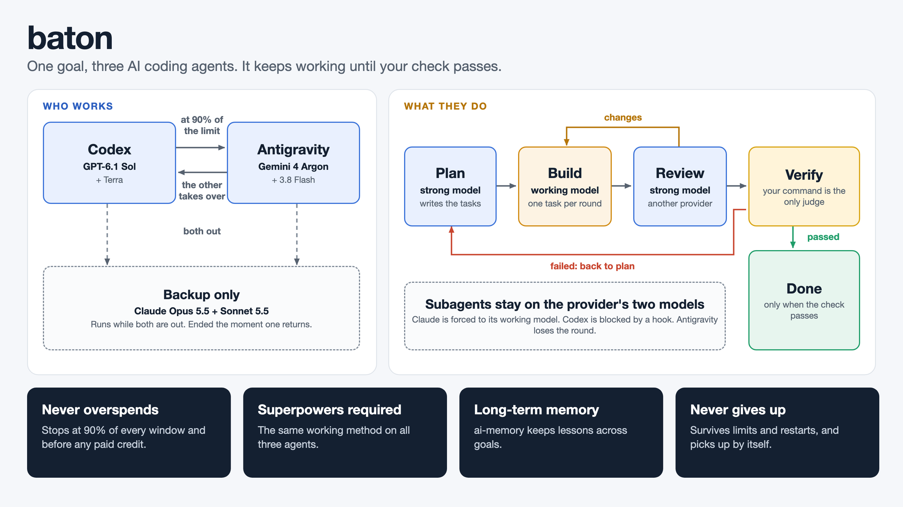
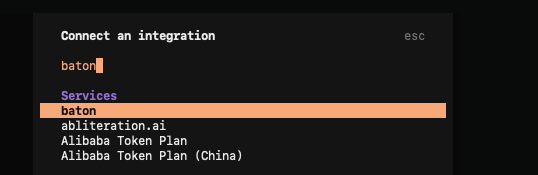
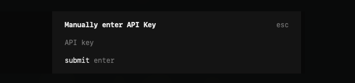
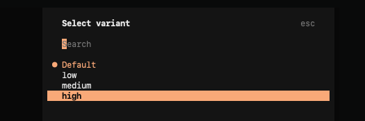
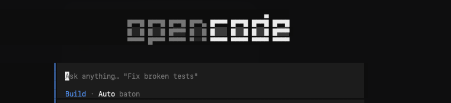

# baton


baton keeps one long coding goal moving for days by passing it between coding agents, stopping
each one before it can spend money it should not. It works with Codex and Antigravity alone;
Claude is an optional third, a paid backup that only joins once you save an API key for it.

You give it a goal (an objective, a working directory and a verification command). It runs one
agent until that agent nears its limit, hands the work to the next, and when every agent is out,
sleeps until the earliest reset and carries on. It finishes only when the verification command
exits 0; an agent saying "done" means nothing.

Every agent runs through its vendor's own CLI. baton reimplements no agent. Context moves between
them through the repository, its commits and a handoff file, and each vendor's own conversation
is resumed when its turn comes again.

Inside a goal the work follows a cycle of plan, build and review, with a strong and a working
model per provider (see [Phases](#phases-plan-build-review)).



## What you need

baton does not bring its own AI or its own methods. It drives tools you install, and works with
two projects it did not write. Everything it depends on or works with:

| Project | What it does for baton | Required? | How to install |
| --- | --- | --- | --- |
| [uv](https://docs.astral.sh/uv/) and Python 3.12 or newer | installs and runs baton; baton itself has no other dependencies | required | the installer on [astral.sh/uv](https://docs.astral.sh/uv/); uv fetches Python 3.12 when it is missing |
| [OpenCode](https://opencode.ai) | the chat window you type in; baton shows up in it as the model `baton/auto` | only for the chat interface: `baton run` works without it | the installer on [opencode.ai](https://opencode.ai) |
| [Codex CLI](https://github.com/openai/codex) | runs GPT models, through your plan | at least one of Codex and Antigravity, signed in to a plan | `npm install -g @openai/codex`, then sign in |
| [Antigravity CLI](https://antigravity.google) (`agy`) | runs Gemini models, through your plan | at least one of Codex and Antigravity, signed in to a plan | the installer on antigravity.google, then sign in |
| [Claude Code](https://claude.com/claude-code) | an optional paid backup that runs only while both others are out | optional; needs a Console API key, not a subscription | install Claude Code, then save the key (Quick start, step 3) |
| [Superpowers](https://github.com/obra/superpowers) | the working methods (planning, test-driven building, verification, code review) that baton puts in every round | **required**, by design: no round runs without it (a goal waits until it is installed), and `baton doctor` fails; see [Superpowers is required](#superpowers-is-required) | `git clone https://github.com/obra/superpowers ~/.config/baton/superpowers`; it is also found automatically from the official Claude Code plugin install, and any other location needs `[superpowers] dir` |
| [ai-memory](https://github.com/akitaonrails/ai-memory) | long-term memory across goals in the same directory | optional | download the release binary for your platform from its releases page and put it on `PATH`; do not run `ai-memory setup`, which wires global hooks (see [Long-term memory](#long-term-memory)) |
| launchd | keeps `baton serve` running in the background on macOS | macOS only, recommended: `baton install-service` | built in to macOS; on Linux keep `baton serve` running in a terminal or tmux |

baton was tested with Codex CLI 0.166.0, Claude Code 2.1.318 and ai-memory 3.4.1. The stream formats
and hook options it relies on are version-specific, so other versions may not behave the same.

**How the pieces fit.** baton owns the rotation, the phases, the limits and the guards. Each vendor
CLI (Codex, Antigravity, Claude Code) does the actual work, one round at a time, inside a model
baton chose. Superpowers gives every round its method. ai-memory gives the goals long-term memory.
OpenCode is the chat window in front of it all.

## Superpowers is required

[Superpowers](https://github.com/obra/superpowers) is not optional, and there is no setting to
turn it off. No round runs without it: a goal that cannot find it waits, still running, and looks
again every 5 minutes, so installing it is all that is needed. The reason is the design: Superpowers
is the working method for every provider. Codex, Antigravity and Claude get the same planning,
test-driven building, verification and review discipline, in every fresh conversation, whichever
agent happens to hold the baton. Install it as the table above says; `baton doctor` fails until it
is found. baton finds it automatically only from the official Claude Code plugin install or from
`~/.config/baton/superpowers`; an install anywhere else needs `[superpowers] dir` in `defaults.toml`.

## Quick start: from zero to your first task

This walks you through everything once, with no prior knowledge of baton. It takes about 15
minutes. The commands assume macOS; on Linux everything works except the background service, so
use the note in step 4.

**Before you start.** Get the tools in [What you need](#what-you-need): at least one of `codex` or
`agy`, signed in to your plan, plus OpenCode for the chat window. Superpowers is installed in step
1.

### 1. Install baton, and Superpowers

```
git clone https://github.com/cahian/baton.git
cd baton
uv tool install .
git clone https://github.com/obra/superpowers ~/.config/baton/superpowers
```

The last line is required, by design: no round runs without Superpowers (see
[Superpowers is required](#superpowers-is-required)).

### 2. Create your settings

```
mkdir -p ~/.config/baton
cp examples/defaults.toml ~/.config/baton/defaults.toml
```

Claude is optional. Open `~/.config/baton/defaults.toml` in any text editor and pick one of these:

- **No Claude (the simplest):** change nothing, and skip step 3. Without a saved key, Claude never
  runs and baton uses Codex and Antigravity only. To switch it off for good, set `enabled = false`
  under `[agents.claude_api]`.
- **With the Claude backup:** set `monthly_budget_usd` to the credit you actually have, and
  `budget_reset_day` to the day of the month it renews. baton stops 10% before that number. Then
  do step 3.

Change `enabled` for `codex` or `antigravity` the same way if you only have one of them.

### 3. Add the Claude key (optional)

Create an API key in the [Claude Console](https://platform.claude.com) and copy it. Then run this,
which saves what you copied into a file only you can read:

```
touch ~/.config/baton/anthropic.key
chmod 600 ~/.config/baton/anthropic.key
pbpaste > ~/.config/baton/anthropic.key
```

Do not paste the key into a chat or into a project.

**Check your billing first.** baton cannot see or change it. If the Console has auto-reload on, or
holds credits you bought, using the key can spend that money. Turn auto-reload off.

### 4. Start baton and check it

```
baton install-service
baton doctor
```

`install-service` keeps baton running in the background, even after a restart. Every line of
`doctor` should read `ok` (Superpowers included); with no Claude key it says `claude_api: not configured (optional)`,
which is fine. `FAIL` tells you what to fix; `warn` is only a heads-up. It spends
nothing, so run it as often as you like.

> **On Linux**, skip `install-service` and leave `baton serve` running in a terminal.

**Optional: long-term memory.** Put the `ai-memory` binary on your `PATH` and baton does the rest;
without it baton works exactly as before. See [Long-term memory](#long-term-memory).

### 5. Add baton to OpenCode

```
baton opencode-config
```

This prints a block of settings. Where it goes depends on whether you already use OpenCode:

- **No `~/.config/opencode/opencode.json` yet:** save it directly:

  ```
  mkdir -p ~/.config/opencode
  baton opencode-config > ~/.config/opencode/opencode.json
  ```

- **You already have that file:** do not run the command above, it would erase your settings.
  Open the file and copy the `baton` entry into your existing `provider` section.

Then tell OpenCode to read the change. If you skip this, baton will not show up:

```
opencode reload
```

### 6. Connect it, once

Use a throwaway folder for your first try. **The agents have full access to the folder where you
open OpenCode**, so do not start in a project you care about:

```
mkdir -p ~/baton-test
cd ~/baton-test
git init
opencode
```

1. Type `/models`. Searching for `baton` shows **No results found**. That is expected the first
   time.
2. Press `ctrl+a` to see all integrations, and choose **baton**.

   

3. It asks for an API key. baton does not need one, but the box cannot be empty. Type `local`
   and press Enter.

   

4. Type `/models` again and choose **Auto**. If OpenCode asks for a variant, keep **Default**.
   baton ignores this setting; effort is set in your `defaults.toml`.

   

You are ready when the box at the bottom says **Auto baton**:



OpenCode remembers the connection, but check that label whenever you open a new session.

### 7. Send your first task

```
Create a hello.py that prints "hi" and run it to check.
```

The answer streams in the chat like any other model. A small request is answered in one round: the
plan finds nothing to build and the cycle ends there. A line tells you each time one agent hands
over to another, and one each time the phase changes. While it works:

- **To change direction,** just send another message. It reaches the agent after its current tool
  call (never later than five minutes after), including a message you type while a reply is
  streaming, which OpenCode would otherwise hold until the reply ends.
- **Closing OpenCode does not stop the work.** It keeps running in the background.

### 8. Watch it, or stop it

Run these in another terminal:

```
baton jobs                   # everything running; names look like session-<id>
baton status session-<id>    # where it is and what it has spent
baton stop session-<id>      # stop it
baton doctor                 # limits and spending right now
```

### 9. Let it run until the job is really done

By default, the work ends when a cycle ends, which for a small request is one round. For a long goal, give baton a test to pass: create a
file named `baton.toml` in your project with the command that proves the job is finished.

```toml
[verify]
command = "./check.sh"
timeout_s = 3600
```

baton then keeps going, across agents and limit resets, until that command succeeds. An agent
saying "done" does not count. Without a good check it may stop too early, and with an impossible
one it will keep trying, so choose something you trust.

### If something goes wrong

| What you see | What to do |
| --- | --- |
| `baton` is not in `/models` | Run `opencode reload`, reopen OpenCode, then do step 6. |
| It asks for an API key | Type `local`. |
| The model still is not listed | In your project, run `echo '{"model":"baton/auto"}' > opencode.json`, then reopen OpenCode. |
| The answer never starts | Run `baton doctor` and `baton jobs`. |
| It says it is waiting | Every agent hit its limit. It resumes alone at the next reset. |
| You want to go back to another model | Choose it in `/models`. Nothing else changes. |

## The rotation

The default order, all at medium effort (the strong tier; [Phases](#phases-plan-build-review)
adds a working model for building):

1. **GPT-6.1 Sol**, through Codex.
2. **Gemini 4 Argon**, through Antigravity (`agy`).
3. **Claude Opus 5.5**, through a Console API key (never a subscription login).

Codex and Antigravity are the plan agents: their included usage comes back at a reset. Claude is
paid by use and has no reset that would ever stop it, so it is a fallback, wherever it stands in
`order`. **Claude runs only while both others are out.**

**Claude is optional.** baton works with Codex and Antigravity alone, and that is the default
experience: until you save a key file (Quick start, step 3), Claude never runs and the rotation is
the other two. It joins as a backup only once the key is there. To turn it off for good, set
`enabled = false` under `[agents.claude_api]` in `defaults.toml`, or leave it out of `order` in a
goal file. `baton doctor` reports an unconfigured Claude as one `ok` line, not a problem.

The first plan agent in `order` starts. The current one keeps working until it is unavailable,
then the next plan agent takes over, wrapping around. A plan agent that comes back does not
preempt another plan agent that is working. When both are out, Claude runs. While it does, baton
reads the plan agents (without a model call) from their reset time onward, at most every 30
seconds, and as soon as one is available it ends the Claude round and that agent takes over. If
both are, the first in `order` goes first. This is not a failure: Claude gets no cooldown. A plan
agent whose round fails within five minutes of such a takeover stops being allowed to end Claude
rounds until it completes one. At most six Claude rounds a day are ended this way (`baton
status` says when the cap is active). When no agent can run, baton waits for the earliest known reset.
Change the order, or disable an agent, in the goal file.

## Phases: plan, build, review

Each provider has a strong model for thinking and a working model for building, and baton applies
the same discipline to all three:

| Provider | Plan and review | Build |
| --- | --- | --- |
| Codex | `gpt-6.1-sol`, medium | `gpt-6.1-terra`, high |
| Antigravity | `gemini-4-argon-medium` | `gemini-3.8-flash-high` |
| Claude | `claude-opus-5-5`, medium | `claude-sonnet-5-5`, high |

This is separate from the rotation: the scheduler still decides who works, and the phases decide
what that agent does and which of its two models runs. State lives in `.baton/PLAN.md` and
`.baton/REVIEW.md`, so any provider can continue a cycle.

1. **Plan** (strong). The agent writes `.baton/PLAN.md` with one `- [ ]` line per task. A request
   small enough to do at once gets no tasks, and the cycle ends there.
2. **Build** (working). One task per round, marked `- [x]` when done. Two completed rounds in a row
   that close no task move on to review; so do 8 rounds in a row of any outcome that close none,
   and so does the build's round cap (3 per task open when the build began, plus 5; a review that
   sends the build back renews it).
3. **Review** (strong). A fresh conversation, by another provider when one is available. It writes
   `.baton/REVIEW.md`, starting with `APPROVED` or `CHANGES`, and adds `- [ ]` tasks for changes.
   Changes go back to build at most 2 times; a third `CHANGES` ends the cycle.
4. **End of cycle.** The verify command runs here, and a failed run goes back to plan. It also
   runs after every 3 rounds without a phase change, whatever their outcome (a timeout resumes
   rather than advances), and a pass finishes the goal as usual. With no verify command, the end
   of a cycle finishes the goal.

A note from a person in the middle of a cycle is delivered as before, outranks the current task,
and changes no phase; a new message starts a new cycle at plan, and `.baton/PLAN.md` and
`REVIEW.md` of the cycle before are moved to `.baton/archive/` (a failed verify keeps them). A
round that does not complete leaves the phase as it was, so the next agent repeats that work. A
Claude round cut off by its own budget cap counts as not complete for the phase and does not
finish a goal. In a directory that is not a git repository there is nothing to review: baton says
so once and ends the cycle after build. `phases = false` in a goal file or `baton.toml` keeps the plain
relay, with the strong model for every round.

**Two guards on the review, enforced by baton and not by a prompt.** baton deletes `REVIEW.md`
just before a review round and reads the verdict only after a round that completed, so an old
`APPROVED` can never approve anything. And if a reviewer changes the code (HEAD moves, or any
tracked or new file outside `.baton/` changes), the review is void: it counts as `CHANGES`, a
`phase` event says `reviewer changed the code`, and a task to review those changes is added to the
plan. A reviewer editing a gitignored file is not detected.

**Subagents are allowed on the provider's two models.** A subagent may use only the strong or the
working model of its provider, exactly, and what enforces that differs by provider.

- **Claude:** every subagent runs on the working model (Sonnet), because baton sets
  `CLAUDE_CODE_SUBAGENT_MODEL` with `CLAUDE_CODE_SUBAGENT_MODEL_FORCE=1`, which makes Claude Code
  drop the `model` parameter: a named model is replaced, not denied. A `PreToolUse` hook stays as a
  second check, and in practice only denies unreadable input or an empty allowed list.
- **Codex:** a `PreToolUse` hook, given per run with `-c` (nothing in `~/.codex` is touched, and
  `features.hooks=true` keeps a config file from turning hooks off), denies a spawn naming a model
  outside the pair before the subagent exists, with a message naming the two allowed ones; the agent
  can retry with an allowed one. A subagent that names no model inherits, unless a role pins one. A
  Codex spawn may not appear in the stream, since the block is in the hook.
  `--dangerously-bypass-hook-trust` also runs any other enabled Codex hooks without review, which
  adds no new capability, since `verify.command` already runs commands.
- **Antigravity:** no hook. baton ends the round (a `subagent` outcome, followed by a pause; three
  in a row rest that agent) when a forbidden model is visible in the stream, and otherwise only
  logs, since its model is rarely shown.

For Claude and Codex the stream only logs subagents as `subagent` events, shown in `baton status`;
it never ends a round. Subagent spend is included in a Claude round's reported cost, which Claude
checks between steps, so `--max-budget-usd` is a soft limit: a round can pass it slightly, and the
10% reserve covers that. Claude runs with a config directory of baton's own
(`<state base>/.claude-config`, mode 700), so a `~/.claude.json` `env` map cannot replace the key or
the base URL.

**Superpowers is applied in every round** (it is [required](#superpowers-is-required)). baton puts
the methods that fit each phase in the prompt of a fresh conversation, under `Skill: <name>`
headings: `writing-plans` for plan, `test-driven-development` and `verification-before-completion`
for build, the code-reviewer prompt for review, and `systematic-debugging` for the plan after a
failed verify, even in a resumed conversation. The phase's own instructions come last. It leaves
out the skills that conflict with baton's own workflow, and says baton's files outrank the
methods'. To use another install, set `[superpowers] dir` in `defaults.toml` (a directory named
there is final: if it is incomplete, Superpowers counts as missing); a repository's `baton.toml`
cannot set it. Files over 64 KB, or 128 KB of text in all, count as missing.

## Long-term memory

`.baton/HANDOFF.md` is short-term: it dies with the goal. [ai-memory](https://github.com/akitaonrails/ai-memory)
is the long-term layer: what past rounds did and learned, searchable, across goals in the same
directory. It adds to the handoff and never replaces it. It is optional: without the binary, or
with memory off, nothing changes, and a memory failure can never stop a goal.

**baton drives it; the agents do not.** baton calls the `ai-memory` command itself, between rounds,
so the same memory reaches Codex, Antigravity and Claude alike. It uses no hooks and no MCP, and
never runs `ai-memory setup`, `install-hooks`, `install-mcp` or `run`.

**What is stored, and where.**

- Before every round, baton searches the project's memory with words from the last verify output
  (at most 16 of them) and the objective (the rest, up to 24 in all), and puts the best 5 hits (6000 characters at most) in the prompt, labelled as
  context that may be out of date, not as instructions. Words are taken from the end of the
  verify output and of the objective, where the errors and the newest message are. The hits sit
  between `--- BEGIN BATON MEMORY ---` and `--- END BATON MEMORY ---`, one line each, starting
  with the page's date and goal.
- After a round that started a process, baton stores one page: the date, the agent, how it ended,
  how long it took, the gate result, the commits it made, and the tails of the verify output, the
  handoff and the round. It is written when the round ends and again, over itself, once the
  verify has run, so a baton killed during the verify still leaves its page. A round that fails,
  times out or has a failing verify is kept as a "gotcha"; a stop, an interrupt, a takeover by
  another agent or a limit is normal rotation.
- Agents are told to keep durable findings under a `## Lessons` heading in the handoff. When that
  section changes, baton stores it as a pinned page that outlives the goal.
- ai-memory redacts secrets before it stores anything. Memory is per directory: a project is the
  directory's name plus a short hash of its full path, and a search never leaves it.
- The data is in `~/.local/state/baton/.ai-memory` (mode 700), with its own config and its own
  port, `127.0.0.1:18778`, so it never meets another ai-memory on the machine. The leading dot
  keeps it clear of every goal's state directory, since no goal can be named that.
  `BATON_STATE_DIR` moves it.
  baton starts the server when it first needs one and leaves it running.
- ai-memory gets only `PATH`, `HOME`, `TMPDIR`, `NO_COLOR` and `RUST_LOG` in its environment, so no
  provider key can reach it, and baton configures no model for it: it uses none.

**Install it** as in [What you need](#what-you-need): the release binary from the
[ai-memory releases](https://github.com/akitaonrails/ai-memory/releases) on your `PATH`, or `bin`
below set to its path. Do not run `ai-memory setup`: it wires hooks into every session on the
machine, which is what baton avoids. Then run `baton doctor`: the
`memory` line shows the binary found and whether the server is up. If you run baton as a service,
re-run `baton install-service` after installing ai-memory, so the service can find it.

**Turn it off.** `memory = false` in a goal file or `baton.toml` turns it off for that project.
`BATON_MEMORY=off` in the environment turns it off everywhere. In `defaults.toml`:

```toml
[memory]
enabled = true
bin = "ai-memory"      # a name on PATH, or a path
port = 18778           # 1024-65535
recall_chars = 6000    # 0-20000; 0 stops recall, recording goes on
```

A `baton.toml` that comes with a repository can only turn memory off or on; it cannot set `bin`
or `port`. A `[memory]` table that cannot be read turns memory off, with one line in `baton status`
and a warning in `baton doctor`.

**Limits.**

- One memory call, starting the server included, is given 8 seconds in all. After any failure
  (server dead, garbage output) baton skips memory for 300 seconds, so a broken memory costs a
  round one short wait at most. A missing binary costs nothing and says nothing; `baton doctor`
  warns. Failures show in `baton status` as `memory` events, never in the chat.
- If you change `port` while the old server is still running, baton starts no second one: it says
  so, in `baton status` and `baton doctor`, and you stop the old server (or set the old port
  back). baton never stops it for you.
- A round that baton had to kill is still recorded, as `interrupted`.
- Recall is keyword search, not understanding: it finds earlier pages that share words with the
  failing output or the objective. It can miss, and it can return something stale.
- Lessons longer than 10000 characters are cut to their last 10000.
- Goals in one directory share one memory; the pages are told apart by goal name.

## How each agent is stopped before it costs money

The failure this exists to prevent: at 100% of its included usage, the Codex CLI keeps working
and silently debits account credits. No error is raised. A design that waits for a limit error
has already paid, so baton reads the limits and acts before they are reached.

| Agent | What is read | Stop condition |
|---|---|---|
| Codex | `codex app-server` rate limits and credit balance. No model call, nothing spent. | 90% used in any window, or the credit balance drops |
| Antigravity | the `/usage` and `/credits` slash commands. No model call, nothing spent. | 90% used in any Gemini row, or the credit balance drops. Both `Gemini Models` rows, Five Hour and Weekly, must be readable |
| Claude | baton's own spend ledger (there is no API that returns the balance) | a spend ceiling of 180 USD by default, and a per-round cap |

Rules that apply to all of them:

- Limits are read before a round and every few seconds during it (15 s for Codex, 30 s for
  Antigravity by default). Reaching the threshold stops the round.
- A balance that moves between the read before the round and any read during it kills the round
  at once (`credit_guard`). Balances are compared as exact decimals.
- Unknown means stop. A read that fails or cannot be parsed never lets an agent run, and two
  failed reads in a row during a round stop it.
- Every agent process has the vendor API-key variables removed from its environment, so a CLI
  cannot fall back to paid API access. The Claude adapter adds its own key back for its process
  only. Before the key is added, every `ANTHROPIC_*`, `CLAUDE_CODE_USE_*`, `CLAUDE_CODE_OAUTH_*`,
  `CLAUDE_CODE_*_FILE_DESCRIPTOR` and `AWS_BEARER_TOKEN_BEDROCK` variable is dropped from the
  Claude round, and a round whose `init` event shows any other credential (a subscription login) is
  refused at once, before any model call.

### The Claude ledger

Claude is billed to the organization's promotional credit, and no API reports what is left, so the
budget is baton's own:

- `monthly_budget_usd` (default 200) minus `reserve_pct` (default 10) is the spend ceiling, 180
  USD. The reserve also absorbs the error of the cost estimate.
- Spend is summed from `total_cost_usd` in each round's result, in one ledger shared by every
  goal (`~/.local/state/baton/claude-spend.json`), under a lock. A period starts on
  `budget_reset_day` at 00:00 UTC.
- Before a round, baton reserves `round_budget_usd` (default 5), passed to Claude as
  `--max-budget-usd`: a soft limit, since the cost (a subagent's included) is checked between
  steps, so a round can pass it slightly and the reserve covers that. If the ceiling would be passed, the round shrinks to what is left, and below
  5 USD the agent is unavailable until the next period.
- A round that ends without a result keeps its whole reservation counted. Crashes overcount and
  never undercount. So does a round ended because a plan agent came back: it has no result, and
  whatever it spent before is counted as the whole 5 USD. The ledger drifts high, never low, and
  the small default keeps that drift small. A corrupt ledger makes the agent unavailable; it is never recreated silently.
- Optionally, `admin_key_file` points to an Admin API key. baton then also reads the Console cost
  report and uses the larger of that and the ledger. It never lowers the ledger, and a failed read
  makes the agent unavailable.
- With no key file, Claude is unavailable with a clear reason and the other agents carry on.

## Honest limits

- **There is a poll gap.** A round can cross from the threshold to 100% between two polls. The 10%
  margin exists for this, and it cannot be made mathematically zero. The account's own setting for
  credits, where it exists, remains the only hard stop.
- **Claude spend is an estimate.** It is computed locally from what the CLI reports. The hard stops
  are in the Console, not in baton.
- **Some Console settings must be right, and baton cannot check them with the key.** Turn
  auto-reload off and hold no purchased credits, since otherwise spending continues after the
  promotional credit ends. Put the key in a dedicated workspace with a monthly spend limit at the
  ceiling. `baton doctor` prints this reminder.
- **Interactive sessions outside baton are not protected.** Codex and Antigravity share one set of
  limits and credits between baton and anything else you run. baton cannot stop your own session,
  but a balance drop it causes still stops baton's round.
- **Antigravity's output when its quota actually runs out has not been observed.** The limit reads
  are expected to stop it first.
- **A response held open for days through OpenCode is untested** beyond seconds. The job does not
  depend on it: `baton jobs` and `baton status session-<id>` show where it is, and a new message
  in the session reattaches the stream.

## Install

```
uv tool install .
baton doctor
```

Python 3.12 or newer. There are no runtime dependencies. You also need the tools in
[What you need](#what-you-need): Superpowers (required), and the CLIs you want to use on your
`PATH` and logged in: `codex`, `agy` and `claude`. Binary paths can be overridden per agent
with `bin`, in a goal file or in `defaults.toml`, since tmux and launchd may not load your shell
aliases. A leading `~` is expanded.

`baton doctor [goal]` checks binaries, logins, stray API-key variables, live limits, Claude's
spend against its ceiling and Superpowers (a blocking failure when it is missing). It spends nothing and exits non-zero on a blocking problem.

## Configuration

### `~/.config/baton/defaults.toml`

Settings applied under every goal. The Claude budget (`monthly_budget_usd`, `reserve_pct`,
`budget_reset_day`) can only be set here, because the ledger it describes is shared; a goal file
that sets them is refused. A full example, also in [`examples/defaults.toml`](examples/defaults.toml):

```toml
[agents.claude_api]
enabled = true
model = "claude-opus-5-5"
effort = "medium"
build_model = "claude-sonnet-5-5"   # the phases' working tier
build_effort = "high"
monthly_budget_usd = 200   # what the organization holds
reserve_pct = 10           # kept back; the spend ceiling is 200 - 10% = 180
budget_reset_day = 1       # day of the month the period starts, 00:00 UTC
round_budget_usd = 5       # most one round may spend (a killed round counts all of it)
key_file = "~/.config/baton/anthropic.key"
admin_key_file = ""        # optional Admin API key file, to cross-check spend

[agents.antigravity]
enabled = true
model = "gemini-4-argon-medium"   # the effort is part of the model id
build_model = "gemini-3.8-flash-high"   # must start with gemini-
threshold_pct = 90
poll_s = 30

[agents.codex]
enabled = true
model = "gpt-6.1-sol"
effort = "medium"
build_model = "gpt-6.1-terra"
build_effort = "high"
threshold_pct = 90
poll_s = 15

# Only here, never in a goal file or a repository's baton.toml. Empty means: search the usual
# places: only the official Claude Code plugin install, then ~/.config/baton/superpowers.
# An install anywhere else needs `dir`.
[superpowers]
dir = ""
```

### The Claude API key

Create the key in the Console, in a dedicated workspace with a monthly spend limit, and store it
where only you can read it:

```
mkdir -p ~/.config/baton
( umask 077; cat > ~/.config/baton/anthropic.key )   # paste the key, then Ctrl-D
chmod 600 ~/.config/baton/anthropic.key
```

baton refuses a key file that is not a regular file with mode 600. It reads the key when it
starts the process and passes it only in that process's environment; it is never logged, stored in
state or given to another agent.

### Goal files

A goal is a TOML file. Only `name`, `workdir` and `objective` are required; everything else has the
default shown in [`examples/goal.toml`](examples/goal.toml):

```toml
name = "example"
workdir = "/path/to/project"
objective = "Make the build pass on all platforms."
phases = true   # false keeps the plain relay, with the strong model for every round
oneshot = false # true pins the objective as the goal when the job first starts

[verify]
command = "./check.sh"
timeout_s = 3600
```

The verification command runs through the shell in the working directory. Exit 0 finishes the
goal; anything else, including a timeout, means not done, and its output goes to the next round.
Without `verify.command`, the goal is finished when a cycle ends (a round, with `phases = false`).

A goal the person fixes (`goal.md` in the state directory, set from OpenCode or with `baton goal`) opens
every prompt, fresh or resumed, with `Goal, fixed by the person. It does not change until the person
changes it:` and its text. It is on while that file is not empty. A goal over 8000 characters goes to
a file under `.baton/notes/` once, and only its first 1000 characters and the file's name are pinned.
`oneshot = true` pins the objective as the goal once, at a job's first start (state.json remembers it),
so a restart never brings back one that was cleared. Only a goal file you pass to `baton run` may set
it: a repository's `baton.toml` is refused, as it would pin text an agent wrote.

Between rounds each agent gets the same context: the repository, its commits, `.baton/HANDOFF.md`
(kept current by the agents), the last gate output and the tail of the previous round. `.baton/`
lives in the working directory and is added to `.git/info/exclude`. A handoff over 16000 characters
is cut in the middle: its first 4000 and its last 12000 are kept, with a line saying how much was
left out. From OpenCode, an over-long conversation keeps the person's messages first, newest first,
each cut to its first 8000 characters, and gives assistant messages the room that is left, each
gap marked with `...`. With `ai-memory` installed, what earlier goals learned in the directory is
added too (see [Long-term memory](#long-term-memory); `memory = false` turns it off). After each round baton commits
uncommitted work locally as `baton: snapshot round <n> (<agent>)` so a hard stop loses nothing. It
never pushes (`snapshot = false` turns the commits off).

### `baton.toml`

When you use baton from OpenCode (below), a `baton.toml` in the project directory plays the role
of the goal file: its `[verify]`, timings and `[agents.*]` settings apply. `name`, `workdir` and
`objective` in it are ignored, since the session decides them. Without one there is no gate, and
the job finishes when a cycle ends (a round, with `phases = false`). An invalid `baton.toml` is an error, never a silent
fall-back to no gate.

A `baton.toml` comes with the repository, so it may not set `bin`, `key_file`, `admin_key_file`,
`full_access` or `poll_s`, and no `[superpowers]` table: a file in a repository must not choose
executables or credentials, which files become part of a prompt, or slow the guard's limit reads.
It may set `phases` and the `build_model` and `build_effort` of an agent: they name models, not
executables. A goal file you pass yourself and the defaults file may set `poll_s`.
Everywhere, `threshold_pct` may not go above 90, and an `antigravity.model` must start with
`gemini-`.

## Using it from OpenCode

OpenCode sees one OpenAI-compatible provider with one model, `baton/auto`, and keeps the history
and context on its side.

1. Print the provider block and merge it into your `opencode.json`:

   ```
   baton opencode-config
   ```

2. Start the gateway. It binds `127.0.0.1` only:

   ```
   baton serve            # --port 18777 by default
   ```

3. Select `baton/auto` in OpenCode and write your request.

Each OpenCode session becomes a job that runs in its own thread inside `baton serve`, independent of
the HTTP connection. A dropped connection never stops it, and a new message in the session becomes
a note that ends the running round once its current tool call is done (after five minutes at the
latest). A message typed while the reply streams, which OpenCode queues in its database and posts
only when the reply ends, is read from there every 2 seconds (read-only, and any failure is
silent), delivered as a note at once, and not delivered again when OpenCode later posts it. Every
conversation of the job reads every note, not only the first one to take it, and a note over 8000
characters goes to a file under `.baton/notes/` in the directory, with its first 1000 characters
and the file's name in the prompt. A message gets at least one round, even if the gate
already passes. A request that repeats what was already accepted, as a client's retry does, attaches
to the stream and interrupts nothing, so it costs no round. `baton jobs` lists every job, and
`baton status`, `baton say`, `baton goal`, `baton next` and `baton stop` accept its name (`session-<id>`) in place of a goal
file. The stream shows the agents' text, one line per rotation, a sentence when a returning plan
agent ends a Claude round, waits and gate results, and when no agent can run it says why, for
each one. Title requests are answered locally and spend nothing. The
working directory is read from OpenCode's own database (`~/.local/share/opencode/opencode.db`, or
the path in `BATON_OPENCODE_DB`); baton never guesses one.

One runner works in a directory at a time, across `baton run` and `baton serve`. A directory inside
or around a running one counts as busy, since the two would commit each other's work.

### Commands in the chat

A message that starts with `baton:` (any case) is a command, not work. They never start with `/`,
which belongs to OpenCode. Text that only contains these words is an ordinary message.

| Message | What it does |
|---|---|
| `baton: goal <text>` | Fix the goal (the rest of the message, over any number of lines). With no job running it starts one with `<text>` as the objective; with one running it is also a note, so the next round reads it. Chat: `[baton] goal set`. |
| `baton: goal off` | Clear the goal, from the next round's prompt, and leave the note `The person cleared the goal.` for the agent. Chat: `[baton] goal cleared`. |
| `baton: next` | Ask for the next agent in the queue after this round. It is stored for the rotation to take. With no job running baton answers in one line and stores nothing. |
| `baton: next now` | The same, and the round ends after its current tool call. |

A command typed while the reply streams goes through the same parsing when baton reads it from
OpenCode's queue, and neither a retry of one nor OpenCode's later post of the same words runs it
twice. Old commands are left out of the conversation a new job is briefed with.

### Keeping it running

Jobs live inside `baton serve`, so keep it alive. If it dies, even by `kill -9`, the next
`baton serve` first ends every agent left behind that it can prove is baton's own, then resumes
every job that had not finished. A job a person stopped stays stopped. A group that cannot be
verified is left alive and its job waits, because two agents at once could spend twice.

On macOS, install it as a launchd service:

```
baton install-service            # --port 18777 by default
```

launchd loads no shell profile, so this resolves everything from the shell you run it in. It finds
each enabled agent's binary and `node`, which `codex` needs, builds `PATH` from their directories,
writes `~/Library/LaunchAgents/local.baton.serve.plist` with absolute paths, and loads it. Running
it again replaces the service. The log is `serve.log` in the state directory. Run it again when an
agent or `node` moves. Your verification commands get that same `PATH`, so a tool they need from
elsewhere must be called by its full path. A verification command that exits 126 or 127 can never
pass, so baton says so once in the chat and in `baton status`, and the rounds go on.

[`examples/baton-serve.plist`](examples/baton-serve.plist) shows the same file with placeholders,
for writing it by hand.

## Commands

| Command | What it does |
|---|---|
| `baton doctor [goal]` | Check binaries, logins, stray API keys, live limits, Claude spend and Superpowers. |
| `baton run <goal.toml>` | Run one goal in the foreground, without OpenCode. |
| `baton serve [--port 18777]` | Start the OpenCode gateway. |
| `baton jobs` | List every job and goal that has state: whether its runner is alive, round, current agent, last event. |
| `baton status <goal.toml or job>` | One-shot status: rounds, cooldowns, recent events. |
| `baton say <goal.toml or job> [--now] "note"` | Leave a note for the next round. `--now` also ends the current one, after its tool call. |
| `baton goal <goal.toml or job> "text"` / `--off` | Fix the goal every prompt opens with, or clear it. |
| `baton next <goal.toml or job> [--now]` | Ask for the next agent in the queue; `--now` also ends the round after its tool call. |
| `baton stop <goal.toml or job> [--now]` | Stop after the current round, or kill the round with `--now`. |
| `baton opencode-config [--port 18777]` | Print the provider JSON for `opencode.json`. |
| `baton install-service [--port 18777]` | Write the launchd plist and load it (macOS). |

State lives in `~/.local/state/baton/<goal name>/` (events, state, raw round logs, inbox), one
runner per goal. `BATON_STATE_DIR` and `BATON_CONFIG` move the goals' state and the defaults file.
`BATON_STATE_DIR` does not move the Claude ledger: it stays at
`~/.local/state/baton/claude-spend.json` under the real home directory, so that no goal can end up
with a ledger, and a budget, of its own. On macOS the runner holds `caffeinate` so the machine does not sleep mid-goal.

baton never exits because of a limit, a transient error, a crash in an agent or bad network. Only a
passing gate, a stop request or a termination signal ends it.

## Development

```
uv sync
uv run pytest -q
uv run ruff check .
uv run ruff format --check .
uv run python scripts/check_private.py
```

Tests never call a real vendor and never read real credential files: fake CLIs and fake limit
readers stand in. `scripts/check_private.py` is part of CI. It fails on any e-mail address, home
path, private or Tailscale address, `.ts.net` hostname, UUID or credential-looking token in a
tracked file or a commit message, because this repository must hold no personal data. Working
notes (`.superpowers/`, `.oneshot-state.md`) stay untracked, and a test enforces it.

The design is in [`docs/specs/2026-11-04-baton-design.md`](docs/specs/2026-11-04-baton-design.md).

## License

MIT. See [LICENSE](LICENSE).

## Credits

baton uses two projects it does not bundle and did not write:

- [Superpowers](https://github.com/obra/superpowers), by Jesse Vincent (MIT): the working methods
  every round is given. baton reads your own install of it and copies none of its files.
- [ai-memory](https://github.com/akitaonrails/ai-memory) (MIT): the long-term memory. baton calls
  its command-line tool and bundles none of it.
